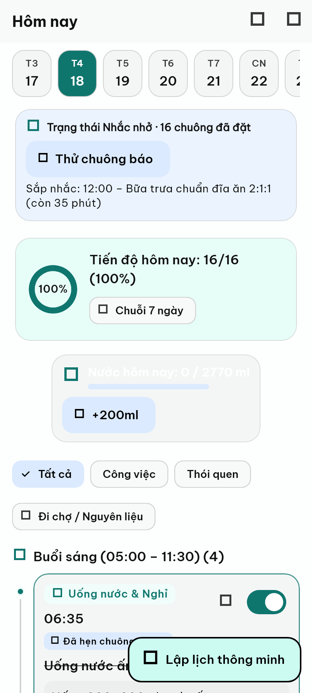
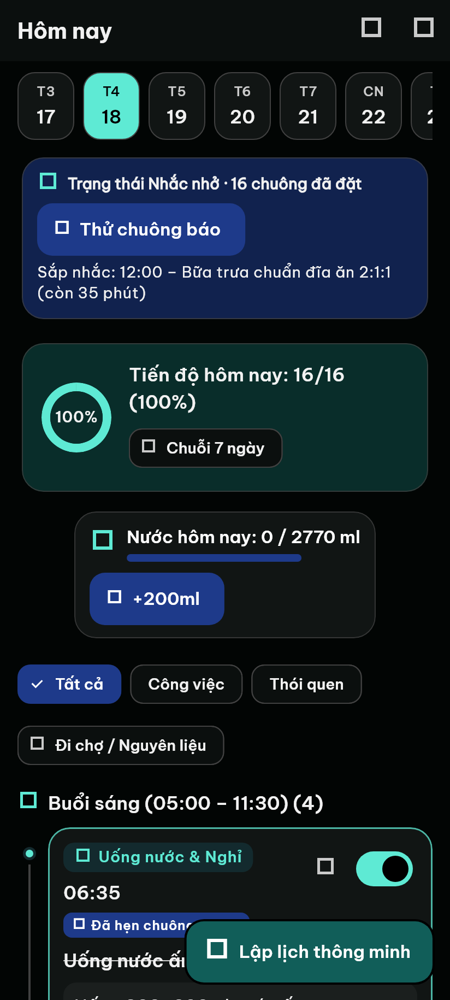
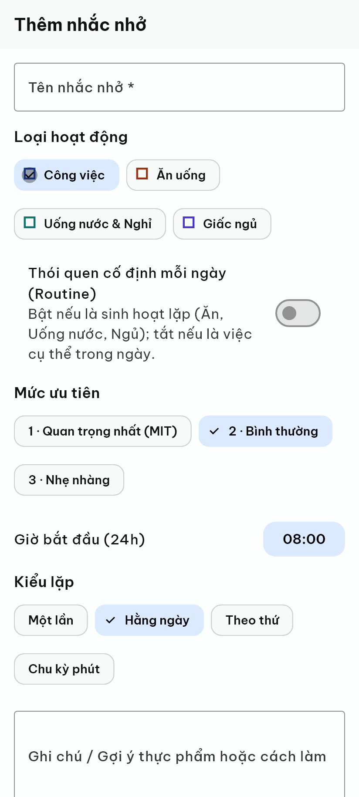
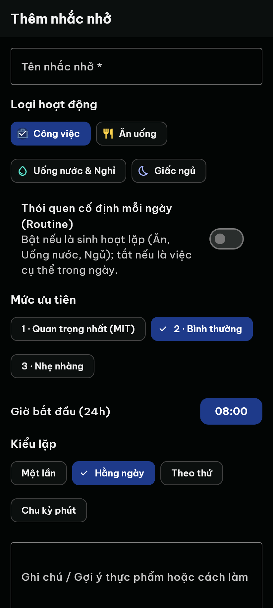
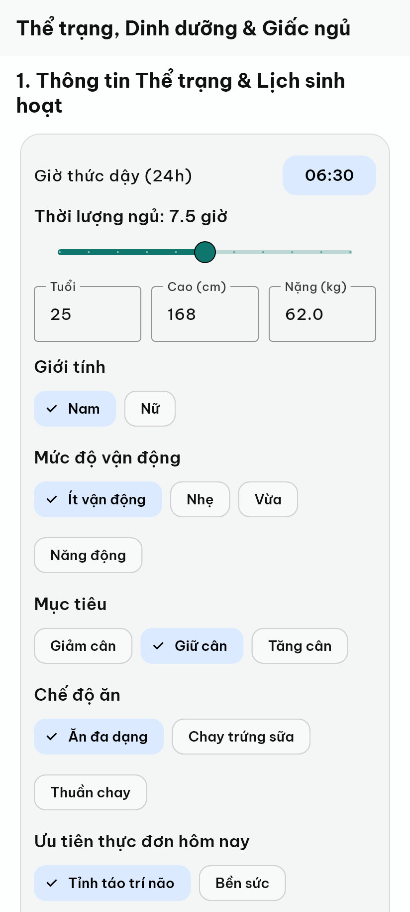
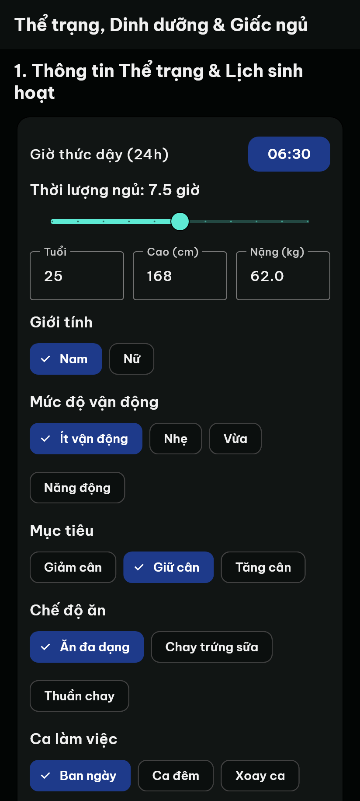
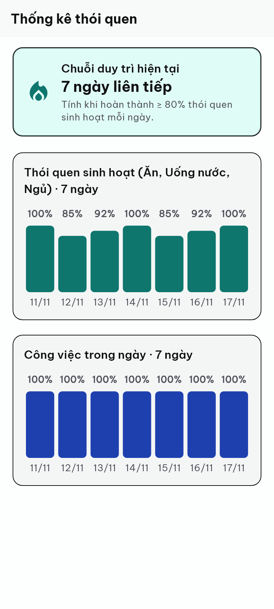
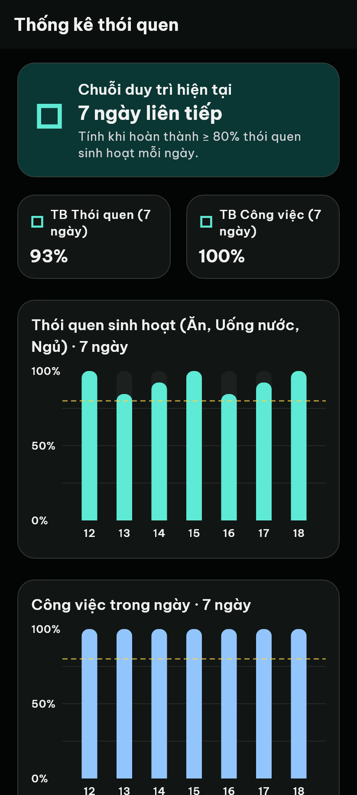
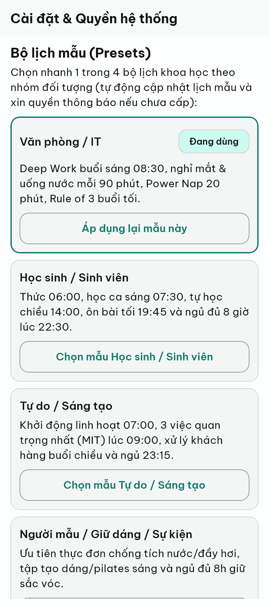
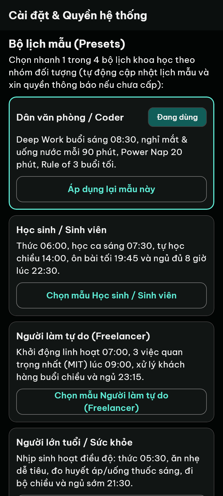

# Nhắc Nhở — Ứng dụng Lập lịch Động, Dinh dưỡng & Giấc ngủ Thông minh (Flutter)

Ứng dụng Flutter **100% Offline** giúp lập lịch làm việc tự động theo nhịp sinh học cá nhân, gợi ý thực đơn 4 chiều, kiểm chứng chuông báo tức thì, trích xuất danh sách đi chợ và dời việc tồn đọng sang ngày mới.

## Tính năng nổi bật (Phase 0 – Phase 8)
- **Lập lịch Động theo Giờ thức (`UniversalDayScheduler` & `SmartPlannerSheet` 3 bước):**
  - Tự neo lịch theo `wakeTime` / `sleepHours` thực tế (hỗ trợ cả ca đêm & xoay ca), xếp việc tập trung cao (`highFocus`) vào đỉnh năng lượng, tự dịch bữa ăn tránh trùng lịch cố định và chèn nhắc nghỉ cho việc >= 60 phút.
  - **Dời việc tồn đọng (Task Rollover):** Tự rà soát công việc chưa hoàn thành (`isRoutine == false`) từ ngày hôm qua để gợi ý đưa vào lịch hôm nay chỉ với 1 chạm.
- **Ma trận Thực phẩm 4 Chiều (`AdaptiveFoodCatalog`) & Danh sách Đi chợ (`ShoppingListExtractor`):**
  - Cá nhân hóa thực đơn Việt theo BMI Châu Á, TDEE, chế độ ăn (`Ăn đa dạng`, `Chay trứng sữa`, `Thuần chay`), lưu ý sức khỏe và ưu tiên trong ngày (`DailyFocusMode`), hiển thị **Food Chips** + nút **Đổi món** trực tiếp trên thẻ.
  - **Đi chợ / Nguyên liệu:** Trích xuất & khử trùng lặp nguyên liệu từ toàn bộ bữa ăn đang bật trong ngày thành checklist tương tác và sao chép nhanh.
- **Kiểm chứng Thông báo & Tránh giờ nghỉ trưa (`NotificationScheduler` & `TimeUtils`):**
  - Thanh **Trạng thái Nhắc nhở** trên màn hình chính hiển thị tổng số chuông đang đặt trong hệ điều hành, đếm ngược tới mốc sắp reo, nút **Thử chuông báo** (kèm `ic_notification` và nút **Hoãn 10 phút** ở slot 99), và Bottom Sheet hàng đợi trong ngày.
  - Tự động lọc bỏ mốc nhắc chu kỳ (`interval`) rơi vào giờ nghỉ trưa `12:30–13:20`.
- **Giao diện Visual Timeline & Bento Grid (`fl_chart`, `lucide_icons_flutter`, `flutter_slidable`):**
  - Chọn nhanh 7 ngày, biểu đồ Donut tiến độ, theo dõi lượng nước `+200ml`, trục thời gian 4 buổi (`Sáng`, `Trưa`, `Chiều`, `Tối`), thống kê 7 ngày `fl_chart`, hỗ trợ `textScaler = 2.0` ở cả Light / Dark / High Contrast.

## Kiến trúc & Kiểm thử
- Kiến trúc 4 tầng phụ thuộc một chiều: `presentation → application → domain ← data` (tầng `domain` là Dart thuần).
- Tài liệu chi tiết: [docs/DEV_GUIDE.md](docs/DEV_GUIDE.md) và [nhac_nho/README.md](nhac_nho/README.md).

```bash
cd nhac_nho
flutter pub get
flutter analyze
flutter test
flutter build apk --debug
```

## Ảnh chụp Giao diện (Light & Dark)
| Màn hình | Chế độ Sáng (Light) | Chế độ Tối (Dark) |
| :--- | :---: | :---: |
| **Hôm nay (Timeline + Chuông báo)** |  |  |
| **Thêm / Sửa nhắc nhở** |  |  |
| **Thể trạng, Dinh dưỡng & Giấc ngủ** |  |  |
| **Thống kê 7 ngày** |  |  |
| **Cài đặt & Presets** |  |  |
